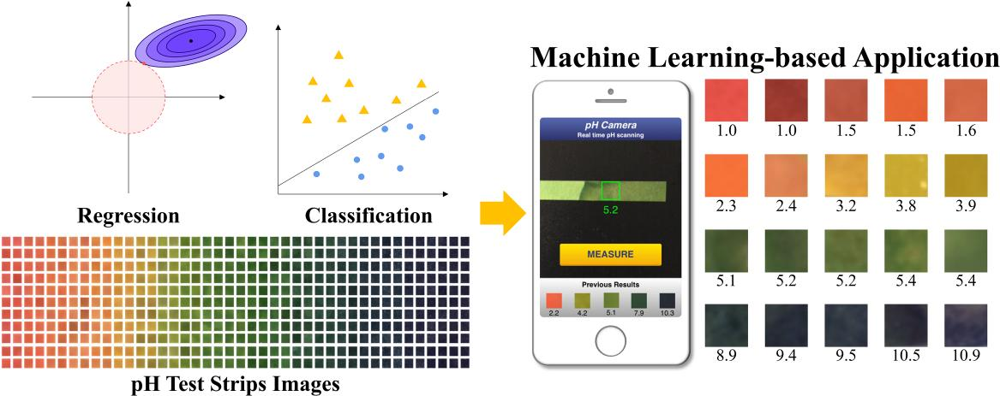
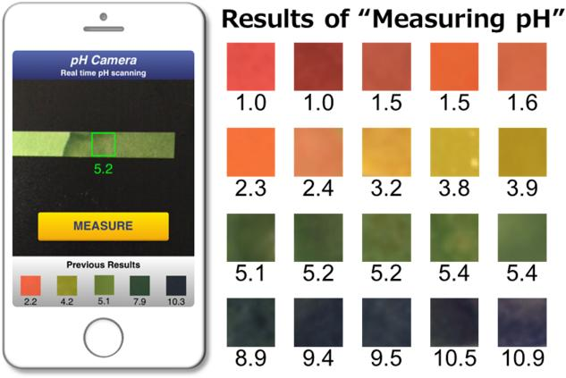
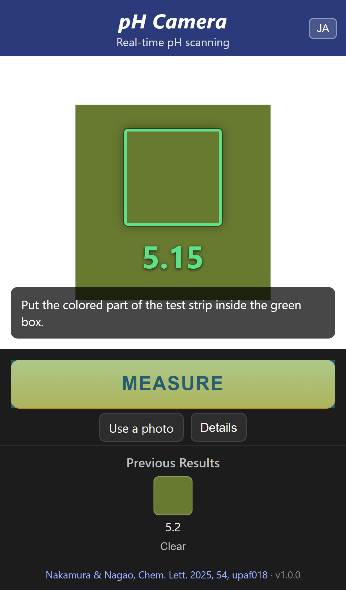
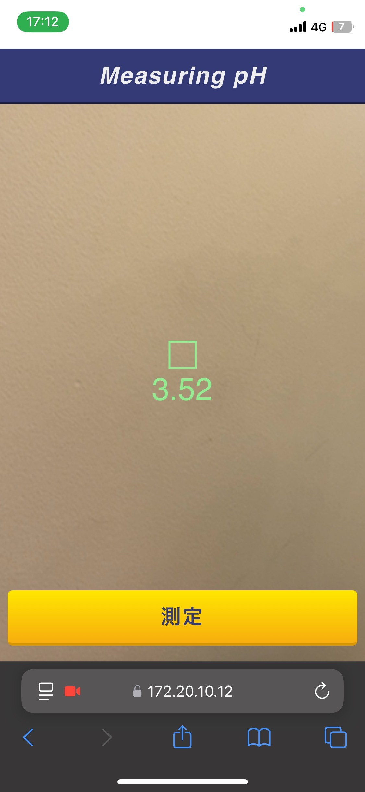
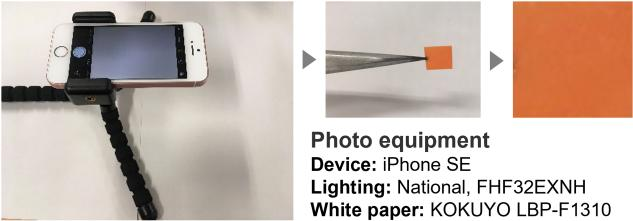

# pH Camera

**複数色空間を用いた機械学習による pH 試験紙画像からの pH 定量**

[](https://doi.org/10.1093/chemle/upaf018)
[](https://github.com/7kamuraNu/pHCamera/actions/workflows/ci.yml)


[English README](README.md)



*Nakamura & Nagao, Chem. Lett. 2025, 54, upaf018 のグラフィカルアブストラクト([CC BY 4.0](https://creativecommons.org/licenses/by/4.0/))。*

pH Camera は、上記論文で報告したリアルタイム pH 測定デモ Web アプリです。スマートフォンのカメラを
万能 pH 試験紙に向けると、1 秒以内に pH 値が表示されます。pH は試験紙の色から推定され、複数の
色空間の変数(RGB の R、HSV の H、CIE L\*a\*b\* の b\*)を組み合わせた軽量モデルを使います。
変数の組み合わせは論文で提案した **Local MAE** 基準で選択しました。深層学習も GPU も不要なので、
サーバーはスマートフォンと同じ Wi-Fi 上のノート PC で十分です。

## 目次

- [仕組み](#仕組み)
- [リポジトリ構成](#リポジトリ構成)
- [クイックスタート](#クイックスタート)
- [スマートフォンから使う](#スマートフォンから使う)
- [検証状況](#検証状況)
- [測定条件と制限](#測定条件と制限)
- [HTTP API](#http-api)
- [開発](#開発)
- [Local MAE](#local-mae)
- [引用](#引用)
- [ライセンス](#ライセンス)

## 仕組み

```
 カメラ映像 ──► 緑の枠(ROI) ──► 枠内の平均色 ──┬─► R, H, b*  ─► 多項式回帰 ─► pH(連続値)
                                              └─► R, G, B   ─► 線形 SVM  ─► pH クラス 1…11
                               |回帰値 − クラス| ≥ 1.0 ならクラスを表示、それ以外は回帰値を表示
```

1. **撮影** ブラウザが背面カメラの映像と緑の正方形(関心領域、ROI)を表示します。0.5 秒ごとに枠内の
   画素を切り出してサーバーへ送ります。
2. **特徴量** サーバーは OpenCV で領域の平均色を求め、HSV と L\*a\*b\* に変換し、論文で選択した
   3 変数 **R, H, b\*** を取り出します。学習データの平均・標準偏差で標準化し、べき多項式に展開します。
3. **回帰** (R, H, b\*) の多項式回帰が連続値の pH を出力します。論文では、全体の MAE ではなく
   Local MAE で変数を選ぶことで、広い pH 範囲で汎化性能の高いモデルが得られました(論文 Table 1)。
4. **分類** 平均 RGB を入力とする線形サポートベクターマシンが pH 1〜11 の整数クラスを判定します。
   440 枚の画像で学習し、論文では分類精度 100 % でした(Supplementary Table S2)。
5. **判定ルール** 回帰値と分類結果の差が 1.0 以上なら分類結果を採用して表示し、それ以外は回帰値を
   表示します。分類結果が採用された場合は UI に「SVM 分類」バッジが付きます。
6. **測定** **測定** ボタンを押すと、その時点の値と色見本が「測定履歴」に保存されます(ブラウザの
   ローカルストレージ)。論文 Fig. 4 の UI を踏襲しています。

<p align="center">
  <br>
  <em>論文 Fig. 4: デモアプリと代表的な測定結果(CC BY 4.0)。</em>
</p>

### 同梱モデル

| モデル | 入力 | 出力 | ファイル |
|--------|------|------|----------|
| RHb\* 多項式回帰 | 標準化した R, H, b\* とその 5 次までのべき(15 特徴量) | pH(連続値) | `models/rhb_poly_regression.json`(`models/RHb_model.sav` から生成) |
| RGB 線形 SVM | 平均 R, G, B(0–255) | pH クラス 1〜11 | `models/rgb_linear_svm.json`(`models/RGB_SVM_model.sav` から生成) |

モデルは scikit-learn 0.22 で学習し、元の pickle をそのまま保存しています。pickle は作成時の
ライブラリバージョンに依存するため、アプリは `scripts/export_models.py` で書き出した JSON の
パラメータを読み込み、NumPy だけで推論します。NumPy 実装が pickle の予測を完全に再現することは
テストで確認しています。入力の定義と標準化定数は [models/README.md](models/README.md) を参照してください。

> **回帰モデルについて** 論文では Local MAE により 3 次モデル RHb\*\_3 を選択しています。本リポジトリに
> 同梱している回帰の重みは、元のデモアプリが使っていたもので、同じ 3 変数(R, H, b\*)を 5 次まで
> 展開したものです。分類モデルは論文に記載のものです。

## リポジトリ構成

```
pHCamera/
├── app.py                  Flask アプリ(UI + JSON API、スマホ向けには `python app.py --https`)
├── phcamera/               Python パッケージ
│   ├── features.py         ROI → 平均 RGB/HSV/Lab → 標準化 (R, H, b*) → 多項式特徴量
│   ├── models.py           NumPy 推論: 多項式回帰、one-vs-one 線形 SVM、判定ルール
│   └── local_mae.py        論文の Local MAE 指標(Fig. 2)
├── models/                 モデルパラメータ(実行時に使う JSON、元の .sav pickle、アーカイブ)
├── scripts/export_models.py  pickle から JSON を再生成し検証するスクリプト
├── templates/index.html    カメラ UI(単一ページ)
├── static/app.js, style.css
├── tests/                  pytest 一式(Playwright によるスマホエミュレーションを含む)
├── docs/                   論文の図、スクリーンショット
├── Dockerfile, Procfile, .python-version   デプロイ用
└── CITATION.cff
```

## クイックスタート

必要環境: Python 3.10 以上。

```bash
git clone https://github.com/7kamuraNu/pHCamera.git
cd pHCamera
python -m venv .venv
# Windows: .venv\Scripts\activate      macOS/Linux: source .venv/bin/activate
pip install -r requirements.txt
python app.py
```

同じ PC のブラウザで <http://localhost:5000> を開きます。`localhost` は安全なオリジンとして
扱われるため、HTTPS なしで Web カメラが使えます。カメラがない場合は **写真を使う** から画像ファイルで
測定できます(写真の中央部分が ROI になります)。

本番用 WSGI サーバーは `gunicorn app:app`、`Procfile`、`Dockerfile` を利用してください。

```bash
docker build -t phcamera . && docker run -p 8000:8000 phcamera
```

## スマートフォンから使う

モバイルブラウザは **安全なオリジン**(`https://` または `localhost`)でしかカメラを使えません。
スマホから `http://<PCのIP>:5000` を開くとその旨の案内と写真による代替手段が表示されます。
リアルタイム測定には HTTPS で配信してください。

**方法 A: 自己署名証明書(最も手軽)**

1. PC とスマホを同じ Wi-Fi に接続します。
2. 一時的な証明書付きでサーバーを起動します(`cryptography` パッケージを使用)。

   ```bash
   python app.py --https
   ```

3. スマホで `https://<PCのIP>:5000` を開きます(IP は `ipconfig` / `ip addr` で確認)。
   証明書の警告を受け入れます。iOS Safari: 「詳細を表示」→「この Web サイトを閲覧」、
   Android Chrome: 「詳細設定」→「アクセスする」。
4. カメラの使用を許可し、試験紙の変色部分を緑の枠に入れて **測定** を押します。

**方法 B: 信頼されたローカル証明書** [mkcert](https://github.com/FiloSottile/mkcert) を使い、
mkcert のルート証明書をスマホに入れておけば警告は出ません。

```bash
mkcert -install
mkcert <PCのIP> localhost
python app.py --cert <PCのIP>+1.pem --key <PCのIP>+1-key.pem
```

**方法 C: トンネルまたはクラウド** `cloudflared tunnel --url http://localhost:5000` や
`ngrok http 5000` で公開 HTTPS URL が得られます。`Dockerfile` / `Procfile` で任意のコンテナ
ホスティングにもデプロイできます。モデルは NumPy のみの軽量なもので、無料枠で十分動作します。

測定のコツ:

- 論文と同様に、白い紙の上に試験紙を置き、直射日光を避けた均一な照明下で、カメラから約 15 cm の
  距離で撮影してください([測定条件](#測定条件と制限)参照)。
- 緑の枠内には試験紙の変色部分だけが入るようにしてください(背景のマスク処理はしていません)。
- 試験紙メーカーが推奨する時間内に測定してください。色は時間とともに変化します。
- **詳細** をタップすると回帰値、SVM クラス、平均 RGB を確認できます。
- `?lang=en` を付けるか **JA/EN** ボタンで UI の言語を切り替えられます。

## 検証状況

| 項目 | 方法 | 状況 |
|------|------|------|
| 特徴量抽出 | OpenCV のスケーリング(H 0–179、Lab オフセット 128)、全画素平均、多項式の順序を単体テスト | 合格 |
| モデル同等性 | NumPy 推論と元の scikit-learn pickle を、乱数 RGB 50,000 点と全サポートベクトルで比較。回帰は乱数特徴量 500 点で比較 | 完全一致 |
| 判定ルール | SVM の全サポートベクトル色で回帰と SVM が 1 pH 以内で一致。上書きルールを合成モデルで検証 | 合格 |
| HTTP API | Flask テストクライアントでデータ URL、生 base64、multipart アップロード、画素/比率 ROI、エラー処理を検証 | 合格 |
| スマホ動作(エミュレーション) | Playwright でヘッドレス Chromium を **iPhone 13** プロファイル(390 × 844 CSS px、DPR 3、タッチ、モバイル UA)で駆動し、白い紙上の pH 5 色の試験紙を模した合成カメラ映像を入力。カメラ起動、リアルタイム pH 表示、画面上の枠が正しい画素に対応すること(平均 RGB が映像の色と ±10 以内)、**測定** で色見本が保存されること、JavaScript エラーがないことを確認。Pixel 7、iPhone SE プロファイルでも確認 | 合格 |
| HTTPS 要件 | 非安全オリジンのエミュレーションで HTTPS の案内表示、測定ボタンの無効化、写真代替の提示を確認 | 合格 |
| 実機 | 元のデモは LAN 上の HTTPS で iPhone/Safari から使用し(`docs/screenshot_iphone_safari.jpg`)、化学実験の授業で学生が使用しました(論文)。本リポジトリの新しい UI は現時点ではエミュレーションでのみ検証 | **実機テスト募集中** |

<p align="center">
  
  &nbsp;&nbsp;
  <br>
  <em>左: 自動化した iPhone 13 エミュレーション(合成カメラ映像)。右: 実機 iPhone 上の元のデモ。</em>
</p>

実機チェックリスト(iOS Safari / Android Chrome):

1. 証明書の警告を受け入れた後、`https://<PCのIP>:5000` が開く。
2. カメラの許可ダイアログが出て、背面カメラの映像が全幅で表示される。
3. 緑の枠の下に約 1 秒以内に pH 値が表示され、連続的に更新される。
4. **測定** を押すと「測定履歴」に色見本と値が追加され、再読み込み後も残る。
5. 画面ロックやアプリ切り替えから戻るとリアルタイム表示が再開する。
6. **写真を使う** でネイティブのカメラ/フォトピッカーが開き、選んだ画像で測定できる。

うまく動かない手順があれば、端末・OS・ブラウザのバージョンを添えて Issue を立ててください。

## 測定条件と制限

モデルは論文に記載の以下の条件で学習しています。

| 項目 | 値 |
|------|----|
| 試験紙 | ADVANTEC 万能 pH 試験紙、pH 1.0–11.0 |
| サンプル | pH 1.0〜11.0 を 0.5 刻み、各 40 枚、計 840 枚(回帰)。分類は 440 枚 |
| カメラ | iPhone SE(第 1 世代)、sRGB、4032 × 3024 |
| 背景 | 白い紙(KOKUYO LBP-F1310) |
| 照明 | 蛍光灯(National FHF32EXNH)、日光なし、照明まで約 3 m、カメラと試験紙の距離約 15 cm |

<p align="center">
  <br>
  <em>論文 Fig. 1: 撮影機材と手順(CC BY 4.0)。</em>
</p>

したがって:

- **カメラ・照明・試験紙の銘柄が変わると色がずれ**、予測 pH もずれます。上表に近い条件で最も良い
  結果が得られます。条件が異なる場合は、その環境で撮影した画像での再学習が必要です。
- 予測が意味を持つのは万能 pH 試験紙の pH 1〜11 の範囲だけです。範囲外の値は UI 上で注意表示されます。
- 本アプリは教育・研究向けのデモであり、校正済み pH メーターの代替ではありません。
- 緑の枠内はそのまま平均されます。試験紙の変色部分だけを枠内に収めてください。

## HTTP API

`POST /api/predict` は JSON または multipart フォームを受け取り、JSON を返します。

```bash
# データ URL を含む JSON("roi" は省略可。画素または画像に対する比率で指定)
curl -s -X POST http://localhost:5000/api/predict \
     -H 'Content-Type: application/json' \
     -d '{"image": "data:image/png;base64,....", "roi": {"x": 0.4, "y": 0.4, "w": 0.2, "h": 0.2}}'

# 切り出した試験紙画像の multipart アップロード
curl -s -F image=@strip.jpg http://localhost:5000/api/predict
```

```json
{
  "ph": 5.1,
  "source": "regression",
  "ph_regression": 5.1,
  "ph_classification": 5.0,
  "mean_rgb": [103.0, 123.0, 48.0],
  "raw_features": {"R": 103.0, "H": 38.0, "b*": 166.0},
  "in_range": true,
  "roi_size": [96, 96]
}
```

`GET /api/info` はモデルの説明(変数、次数、クラス、上書きしきい値)を返し、`GET /healthz` は
死活監視用です。エラーは `{"error": "..."}` をステータス 400 で返します。

## 開発

```bash
pip install -r requirements-dev.txt
playwright install chromium          # スマホエミュレーションテスト用(初回のみ)
pytest                               # 全テスト(約 10 秒)
pytest -m "not e2e"                  # 単体テストのみ
PHCAM_E2E_SCREENSHOT=1 pytest -m e2e # docs/e2e_iphone_emulation.png も更新
python scripts/export_models.py      # pickle から models/*.json を再生成(scikit-learn が必要)
```

GitHub Actions では Python 3.10〜3.12 で単体テストを実行し、書き出した JSON が最新であることを
確認し、スマホエミュレーションテストを実行します。

## Local MAE

論文ではモデル選択のために *Local MAE* を導入しました。pH 水準ごとに平均絶対誤差を計算し、その
**最大値** をモデルの代表値とします。全体の MAE ではなく Local MAE で選択することで、平均的には
正確でも特定の pH 域で誤差が大きいモデルが排除され、論文では全体 MAE で選んだモデル
(RGHSVb\*y\_3)より単純で汎化性能の高いモデル(RHb\*\_3)が得られました。

```python
from phcamera import local_mae, per_level_mae

local_mae(y_true, y_pred)      # pH 水準ごとの MAE の最大値
per_level_mae(y_true, y_pred)  # {pH 水準: MAE}
```

## 引用

本コードやモデルを利用する場合は、以下の論文を引用してください。

```bibtex
@article{Nakamura2025pHCamera,
  author  = {Nakamura, Yuto and Nagao, Masahiro},
  title   = {Machine learning-based {pH} quantification from test strip images using multiple color spaces},
  journal = {Chemistry Letters},
  year    = {2025},
  volume  = {54},
  number  = {2},
  pages   = {upaf018},
  doi     = {10.1093/chemle/upaf018}
}
```

機械可読な引用情報は [CITATION.cff](CITATION.cff) にあります。

## ライセンス

ソースコードとモデルファイルのライセンスは未設定です。再配布の前に著者へご連絡ください。
`docs/` 内のグラフィカルアブストラクトと図はオープンアクセス論文からの転載で、著者により
[CC BY 4.0](https://creativecommons.org/licenses/by/4.0/) でライセンスされています。

## 著者

Yuto Nakamura(名古屋大学 未来社会創造機構)、Masahiro Nagao(名古屋大学大学院 環境学研究科)
