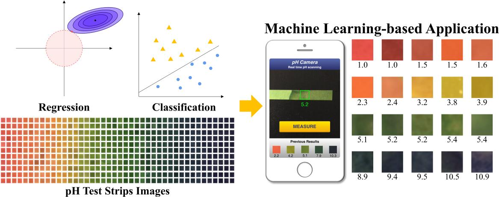
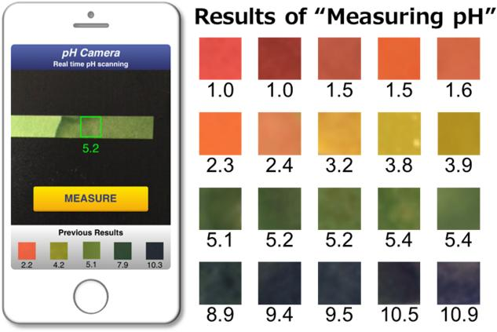
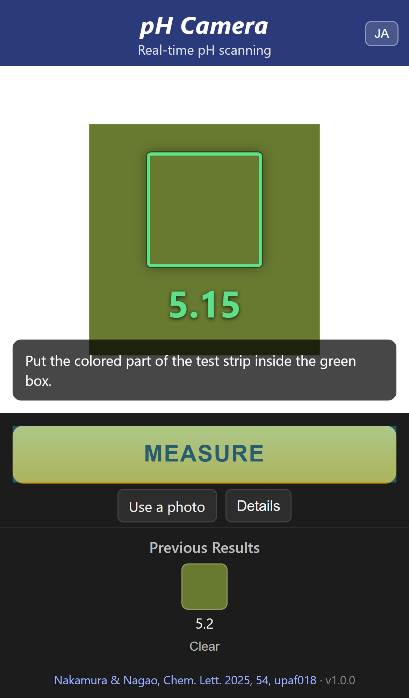
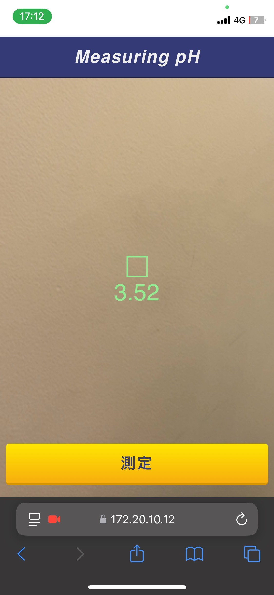
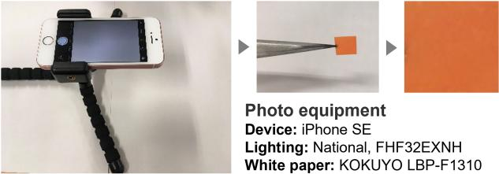

# pH Camera

**Machine learning-based pH quantification from test strip images using multiple color spaces**

[](https://doi.org/10.1093/chemle/upaf018)
[](https://github.com/7kamuraNu/pHCamera/actions/workflows/ci.yml)

[](LICENSE)

[日本語版 README はこちら](README.ja.md)



*Graphical abstract of Nakamura & Nagao, Chem. Lett. 2025, 54, upaf018 ([CC BY 4.0](https://creativecommons.org/licenses/by/4.0/)).*

pH Camera is the real-time pH measurement web application described in the paper above.
Point a smartphone camera at a universal pH test strip and the app reports its pH value
in under a second. The pH is estimated from the strip color with a lightweight model that
combines variables from several color spaces (R from RGB, H from HSV, b\* from CIE L\*a\*b\*),
selected with the *Local MAE* criterion introduced in the paper. No deep learning and no
GPU are needed, so the server can be a laptop on the same Wi-Fi as the phone.

## Contents

- [How it works](#how-it-works)
- [Repository layout](#repository-layout)
- [Quick start](#quick-start)
- [Using it from a smartphone](#using-it-from-a-smartphone)
- [Verification status](#verification-status)
- [Measurement conditions and limitations](#measurement-conditions-and-limitations)
- [HTTP API](#http-api)
- [Development](#development)
- [Local MAE](#local-mae)
- [Citation](#citation)
- [License](#license)

## How it works

```
 phone camera ──► green ROI box ──► mean color of ROI ──┬─► R, H, b*  ─► polynomial regression ─► pH (continuous)
                                                        └─► R, G, B   ─► linear SVM            ─► pH class 1…11
                                           |regression − class| ≥ 1.0 ? show class : show regression
```

1. **Capture.** The browser shows the rear-camera stream with a green square (region of
   interest). Every 0.5 s the pixels inside the square are cropped and posted to the server.
2. **Features.** The server computes the mean color of the region with OpenCV, converts it to
   HSV and L\*a\*b\*, and keeps the three variables selected in the paper: **R**, **H** and
   **b\***. They are standardized with the training-set statistics and expanded into a power
   polynomial.
3. **Regression.** A polynomial regression on (R, H, b\*) outputs a continuous pH value.
   In the paper, choosing the variable set by Local MAE instead of overall MAE gave a model
   with better generalization across the whole pH range (Table 1 of the paper).
4. **Classification.** A linear support vector machine on the mean RGB assigns one of the
   eleven integer classes pH 1 … 11. It was trained on 440 images and reached 100 %
   classification accuracy in the paper (Supplementary Table S2).
5. **Decision rule.** If the regression output and the class differ by 1.0 or more, the
   classification result is trusted and displayed; otherwise the regression value is shown.
   The UI marks such readings with an "SVM classification" badge.
6. **Measure.** Pressing **MEASURE** stores the current value and a color swatch in
   "Previous Results" (kept in the browser's local storage), mirroring the UI in Fig. 4 of
   the paper.

<p align="center">
  <br>
  <em>Fig. 4 of the paper: the demo application and representative measurements (CC BY 4.0).</em>
</p>

### Models shipped in this repository

| Model | Input | Output | File |
|-------|-------|--------|------|
| RHb\* polynomial regression | standardized R, H, b\* and their powers up to 5 (15 features) | pH (continuous) | `models/rhb_poly_regression.json` (from `models/RHb_model.sav`) |
| RGB linear SVM | mean R, G, B (0–255) | pH class 1 … 11 | `models/rgb_linear_svm.json` (from `models/RGB_SVM_model.sav`) |

The models were trained with scikit-learn 0.22 and are kept as the original pickles. Because
pickles are tied to the library version that wrote them, the application reads the fitted
parameters from JSON files exported by `scripts/export_models.py` and evaluates them with NumPy.
The test suite checks that the NumPy implementation reproduces the pickles' predictions exactly.
See [models/README.md](models/README.md) for the input definition and standardization constants.

> **Note on the regression model.** The paper selects the 3rd-order model RHb\*\_3 by Local MAE.
> The regression weights bundled here are the ones the original demo application shipped with:
> the same three variables (R, H, b\*), expanded to the 5th order. The classification model is
> the one described in the paper.

## Repository layout

```
pHCamera/
├── app.py                  Flask application (UI + JSON API, `python app.py --https` for phones)
├── phcamera/               Python package
│   ├── features.py         ROI → mean RGB/HSV/Lab → standardized (R, H, b*) → polynomial features
│   ├── models.py           NumPy inference: polynomial regression, one-vs-one linear SVM, decision rule
│   └── local_mae.py        Local MAE metric from the paper (Fig. 2)
├── models/                 Model parameters (JSON used at runtime, original .sav pickles, archive)
├── scripts/export_models.py  Regenerates the JSON parameters from the pickles and verifies them
├── templates/index.html    Single-page camera UI
├── static/app.js, style.css
├── tests/                  pytest suite incl. smartphone emulation (Playwright)
├── docs/                   Figures from the paper, screenshots
├── Dockerfile, Procfile, .python-version   Deployment
└── CITATION.cff
```

## Quick start

Requirements: Python 3.10 or newer.

```bash
git clone https://github.com/7kamuraNu/pHCamera.git
cd pHCamera
python -m venv .venv
# Windows: .venv\Scripts\activate      macOS/Linux: source .venv/bin/activate
pip install -r requirements.txt
python app.py
```

Open <http://localhost:5000> in a browser on the same computer. `localhost` counts as a secure
origin, so the webcam works without HTTPS. If there is no camera, use **Use a photo** to measure
from an image file; the center of the photo is used as the region of interest.

For a production WSGI server use `gunicorn app:app`, the `Procfile`, or the `Dockerfile`:

```bash
docker build -t phcamera . && docker run -p 8000:8000 phcamera
```

## Using it from a smartphone

Mobile browsers expose the camera only to **secure origins** (`https://` or `localhost`).
Opening `http://<PC-IP>:5000` from a phone shows a notice explaining this and offers the
photo fallback; for live scanning serve the app over HTTPS.

**Option A: self-signed certificate (quickest)**

1. Connect the PC and the phone to the same Wi-Fi.
2. Start the server with a temporary certificate (uses the `cryptography` package):

   ```bash
   python app.py --https
   ```

3. On the phone open `https://<PC-IP>:5000` (find the IP with `ipconfig` / `ip addr`).
   Accept the certificate warning: Safari on iOS → *Show Details* → *visit this website*;
   Chrome on Android → *Advanced* → *Proceed*.
4. Allow camera access when asked. Place the colored part of the strip inside the green box
   and press **MEASURE**.

**Option B: trusted local certificate** with [mkcert](https://github.com/FiloSottile/mkcert),
which avoids the warning once the mkcert root is installed on the phone:

```bash
mkcert -install
mkcert <PC-IP> localhost
python app.py --cert <PC-IP>+1.pem --key <PC-IP>+1-key.pem
```

**Option C: tunnel or cloud.** A tunnel such as `cloudflared tunnel --url http://localhost:5000`
or `ngrok http 5000` gives a public HTTPS URL, and the `Dockerfile` / `Procfile` deploy to any
container host. The model is tiny (NumPy only), so a free-tier instance is sufficient.

Tips for good readings:

- Keep the strip on white paper under even lighting without direct sunlight, about 15 cm from
  the camera, as in the paper (see [conditions](#measurement-conditions-and-limitations)).
- Fill the green box with the colored part of the strip only; the background is not masked.
- Measure within the time window recommended by the strip manufacturer; the color keeps changing.
- Tap **Details** to see the regression value, the SVM class and the mean RGB behind a reading.
- Add `?lang=ja` or tap the **JA/EN** button to switch the UI language.

## Verification status

| Check | How | Status |
|-------|-----|--------|
| Feature extraction | Unit tests against OpenCV's known scaling (H 0–179, Lab offset 128), mean over all pixels, polynomial order | passing |
| Model equivalence | NumPy inference compared with the original scikit-learn pickles on 50 000 random RGB values and all support vectors; regression on 500 random feature vectors | identical |
| Decision rule | Regression and SVM agree within 1 pH unit on every SVM support-vector color; override rule tested with synthetic models | passing |
| HTTP API | Flask test client: data URL, raw base64, multipart upload, pixel / fractional ROI, error handling | passing |
| Smartphone flow (emulated) | Playwright drives headless Chromium with the **iPhone 13** profile (390 × 844 CSS px, DPR 3, touch, mobile user agent) and a synthetic camera stream showing a pH-5 colored strip on white paper. Checks: camera starts, a live pH value appears, the on-screen box is mapped to the right source pixels (mean RGB within ±10 of the stream color), **MEASURE** stores a swatch, no JavaScript errors. Also checked for the Pixel 7 and iPhone SE profiles. | passing |
| HTTPS requirement | Emulated phone over a non-secure origin shows the HTTPS notice, disables MEASURE and offers the photo fallback | passing |
| Real devices | The original demo was used on iPhone/Safari over HTTPS on a LAN (`docs/screenshot_iphone_safari.jpg`) and by students during chemistry laboratory classes (paper). The rewritten UI in this repository has so far been verified in emulation only. | **please test and report** |

<p align="center">
  
  &nbsp;&nbsp;
  <br>
  <em>Left: automated iPhone 13 emulation (synthetic camera stream). Right: the original demo on a real iPhone.</em>
</p>

Real-device checklist (iOS Safari and Android Chrome):

1. `https://<PC-IP>:5000` opens after accepting the certificate warning.
2. The camera permission prompt appears and the rear camera stream is shown full-width.
3. A pH value appears under the green box within about one second and updates continuously.
4. **MEASURE** adds a swatch with the value to *Previous Results*; results survive a reload.
5. Locking the phone or switching apps and returning resumes the live reading.
6. **Use a photo** opens the native camera / photo picker and measures the selected image.

Please open an issue with the device, OS and browser version if any step fails.

## Measurement conditions and limitations

The models were trained under the conditions reported in the paper:

| Item | Value |
|------|-------|
| Test strips | ADVANTEC Universal pH paper, pH 1.0–11.0 |
| Samples | pH 1.0 to 11.0 in 0.5 steps, 40 photographs each, 840 images (regression); 440 images (classification) |
| Camera | iPhone SE (1st generation), sRGB, 4032 × 3024 |
| Background | White paper (KOKUYO LBP-F1310) |
| Lighting | Fluorescent lamp (National FHF32EXNH), no sunlight, lamp ≈ 3 m above, camera ≈ 15 cm from the strip |

<p align="center">
  <br>
  <em>Fig. 1 of the paper: photographing equipment and procedure (CC BY 4.0).</em>
</p>

Consequently:

- **Different cameras, lighting or strip brands shift the colors** and therefore the predicted pH.
  Expect the best results with conditions close to the table above; otherwise the model needs
  to be re-trained on images from your setup.
- Predictions are only meaningful for universal indicator strips in the pH 1–11 range. Readings
  outside that range are flagged in the UI.
- The app is a demonstration for teaching and research, not a replacement for a calibrated pH meter.
- The region inside the green box is averaged as is; include only the colored strip area.

## HTTP API

`POST /api/predict` accepts either JSON or a multipart form and returns JSON.

```bash
# JSON with a data URL (optional "roi" in pixels or fractions of the image)
curl -s -X POST http://localhost:5000/api/predict \
     -H 'Content-Type: application/json' \
     -d '{"image": "data:image/png;base64,....", "roi": {"x": 0.4, "y": 0.4, "w": 0.2, "h": 0.2}}'

# multipart upload of a cropped strip image
curl -s -F image=@strip.jpg http://localhost:5000/api/predict
```

```json
{
  "ph": 5.1,
  "source": "regression",
  "ph_regression": 5.1,
  "ph_classification": 5.0,
  "mean_rgb": [103.0, 123.0, 48.0],
  "raw_features": {"R": 103.0, "H": 38.0, "b*": 166.0},
  "in_range": true,
  "roi_size": [96, 96]
}
```

`GET /api/info` returns the model description (variables, degree, classes, override threshold);
`GET /healthz` is a liveness probe. Errors are returned as `{"error": "..."}` with status 400.

## Development

```bash
pip install -r requirements-dev.txt
playwright install chromium          # once, for the smartphone emulation test
pytest                               # everything (≈ 10 s)
pytest -m "not e2e"                  # unit tests only
PHCAM_E2E_SCREENSHOT=1 pytest -m e2e # also refreshes docs/e2e_iphone_emulation.png
python scripts/export_models.py      # regenerate models/*.json from the pickles (needs scikit-learn)
```

GitHub Actions runs the unit tests on Python 3.10–3.12, checks that the exported JSON is up to
date, and runs the smartphone emulation test.

## Local MAE

The paper introduces *Local MAE* for model selection: the mean absolute error is computed for
each pH level separately and the **maximum** over levels represents the model. Selecting by
Local MAE instead of the overall MAE penalizes models that are accurate on average but poor in a
particular pH range, and in the paper it yielded a simpler model (RHb\*\_3) with better
generalization than the overall-MAE winner (RGHSVb\*y\_3).

```python
from phcamera import local_mae, per_level_mae

local_mae(y_true, y_pred)      # max over pH levels of the per-level MAE
per_level_mae(y_true, y_pred)  # {pH level: MAE}
```

## Citation

If you use this code or the models, please cite the paper:

```bibtex
@article{Nakamura2025pHCamera,
  author  = {Nakamura, Yuto and Nagao, Masahiro},
  title   = {Machine learning-based {pH} quantification from test strip images using multiple color spaces},
  journal = {Chemistry Letters},
  year    = {2025},
  volume  = {54},
  number  = {2},
  pages   = {upaf018},
  doi     = {10.1093/chemle/upaf018}
}
```

A machine-readable citation is in [CITATION.cff](CITATION.cff).

## License

The source code and model files are released under the [MIT License](LICENSE).
The graphical abstract and figures in `docs/` are taken from the open-access paper and are
licensed [CC BY 4.0](https://creativecommons.org/licenses/by/4.0/) by the authors; please keep
the citation when reusing them.

## Authors

Yuto Nakamura (Institutes of Innovation for Future Society, Nagoya University) and
Masahiro Nagao (Graduate School of Environmental Studies, Nagoya University).
